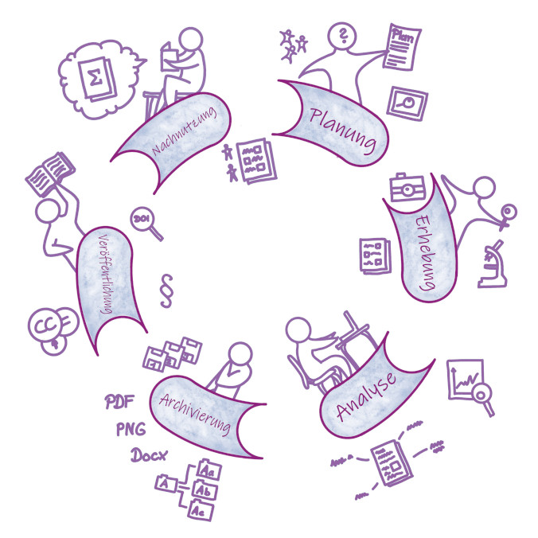
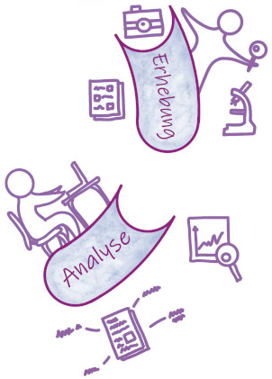
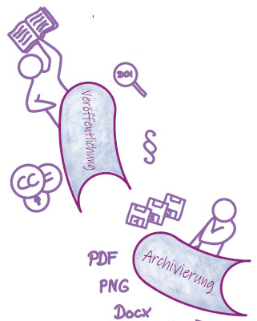
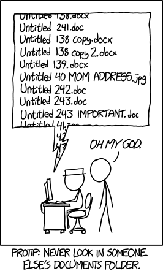

<!--

author:   Britta Petersen
email:    b.petersen@rz.uni-kiel.de
version:  0.2.0
language: de
narrator: DE German Female

link: https://raw.githubusercontent.com/RDM4CAU/Intro-to-RDM/refs/heads/main/cau-style.css

icon:     images/Logo_cau-norm-de-lilagrey-rgb-0720_2022.png

comment:  Einführung in das Thema Forschungsdatenmanagement im Rahmen der Übung: Archäologische Datenmodellierung, Datenerfassung und Forschungsdatenmanagement

licence: CC BY 4.0

-->

# Forschungsdatenmanagement

<center>

<!-- style="width: 40%" -->

</center>

<br>
<br>

>**Britta Petersen** - [Zentrales Forschungsdatenmanagement](https://www.fdm.uni-kiel.de/de)

<div style="page-break-after: always;"></div>

# Disclaimer

>KurzURL zu dieser Präsentation: []()

>**Disclaimer**: Please note that you are leaving the CAU pages once you open this presentation in your browser. This presentation includes links to other third party websites and services. When you click on these links you will leave this presentation and will be redirected to the respective another sites. These sites are not under our control.
>
>RDM@CAU is not responsible for the content of linked third party websites. Please be aware that the security and privacy policies on these sites may be different than CAU policies, so please read third party privacy and security policies closely.
>
> If you need help, feel free to ask:
>
> [b.petersen@rz.uni-kiel.de](mailto:b.petersen@rz.uni-kiel.de)
>
> ____________________________________________
>
>  This work is licensed under a [Creative Commons Attribution 4.0 International License](https://creativecommons.org/) with exception of the used material from other copyright holders.

<div style="page-break-after: always;"></div>

# Lernziele 🎯

>[!IMPORTANT]Nach dieser Sitzung könnt Ihr …
>
> - den Begriff Forschungsdaten erläutern und Beispiele aus der Ur- und Frühgeschichte benennen.
>
> - die Relevanz von Forschungsdatenmanagement für Nachvollziehbarkeit, Nachprüfbarkeit und Nachnutzbarkeit (archäologischer) Forschungsergebnisse erläutern.
>
> - die FAIR-Prinzipien und den Forschungsdatenlebenszyklus als Orientierungsmodelle für den Umgang mit Forschungsdaten beschreiben.
>
> - für ein archäologisches Beispielprojekt eine nachvollziehbare Ordnerstruktur und Dateibenennungskonvention entwerfen und diese in einer README-Datei dokumentieren.

# Forschungsdatenmanagement … ? 🤹

{{0-1}}
********************************************************************************

<!-- style="font-size: 30px;" -->
> Forschungsdatenmanagement (FDM) umfasst alle Prozesse der **Transformation**, **Selektion** und **Speicherung** von Forschungsdaten mit dem gemeinsamen **Ziel**, diese *~~langfristig~~* und *~~personenunabhängig~~* **zugänglich**, **nachnutzbar** und **nachprüfbar** zu halten.
>
><small>www.forschungsdaten.info</small>


********************************************************************************

{{1}}
********************************************************************************

Zentrale Aspekte des FDM
---

- **Datenorganisation**: Strukturierung und Dokumentation von Daten

- **Datenqualität und -integrität**: Sicherstellung, dass die Daten korrekt, vollständig und zuverlässig sind.

- **Datensicherheit**: Schutz vor Datenverlusten, Schutz von sensiblen Daten

- **Datenarchivierung**: Langfristige Speicherung und Zugänglichmachung von Daten.

- **Datenzugang und -verfügbarkeit**: Sicherstellung, dass Daten zugänglich sind.

- **Datenethik und -recht**: Einhaltung gesetzlicher Bestimmungen, Datenschutzvorgaben und ethischer Richtlinien beim Umgang mit Forschungsdaten.

********************************************************************************

<div style="page-break-after: always;"></div>

## Relevanz von FDM

{{0}}
****************

><big>Movie time! 📽️😀</big>
>
>---
>__Lasst uns diskutieren!__
>
>Könnt Ihr Euch eine ähnliche Situation in der Ur- und Frühgeschichte vorstellen?
>
>Warum ist FDM wichtig?
****************

---

<iframe width="100%" height="50%" src="https://www.youtube.com/embed/66oNv_DJuPc
" title="YouTube video player" frameborder="0" allow="accelerometer; autoplay; clipboard-write; encrypted-media; gyroscope; picture-in-picture; web-share" allowfullscreen></iframe>

<div style="page-break-after: always;"></div>


# Forschungsdaten 🧪

{{0-1}}
********************************************************************************

<!-- style="font-size: 30px;" -->
>**Lasst uns kurz gemeinsam sammeln!**
>
>Welche Forschungsdaten entstehen in einem archäologischen Forschungsprozess?
>
>**Nennt alle Beispiele, die Euch einfallen!**
>
>https://answergarden.ch/5230724

********************************************************************************

{{1-2}}
********************************************************************************

<iframe src="https://answergarden.ch/5230724" style="border:0px;width:100%;height:500px" allowfullscreen="true" webkitallowfullscreen="true" mozallowfullscreen="true"></iframe>

<div style="page-break-after: always;"></div>

********************************************************************************

{{2-3}}
********************************************************************************
<!-- style="font-size: 25px;" -->
Die DFG schreibt hierzu:

> „Zu Forschungsdaten zählen u. a. Messdaten, Laborwerte, audiovisuelle Informationen, Texte, Surveydaten oder Beobachtungsdaten, methodische Testverfahren sowie Fragebögen. Korpora und Simulationen können ebenfalls zentrale Ergebnisse wissenschaftlicher Forschung darstellen und werden daher ebenfalls unter den Begriff Forschungsdaten gefasst. Da Forschungsdaten in einigen Fachbereichen auf der Analyse von Objekten basieren (z. B. Gewebe-, Material-, Gesteins-, Wasser- und Bodenproben, Prüfkörper, Installationen, Artefakte und Kunstgegenstände), muss der Umgang mit diesen ebenso sorgfältig sein und eine fachlich adäquate Nachnutzungsmöglichkeit, wann immer sinnvoll und möglich, mitgedacht werden. Ähnliches gilt, wenn Software für die Entstehung oder Verarbeitung von Forschungsdaten erforderlich ist.“
>
> (**DFG 2021**)

***********************************************************

{{3}}
***********************************************************

 <!-- width="350px" align="right" -->

<!-- style="font-size: 25px;" -->
**Beispiele für Forschungsdaten**:

- Audio- und Videoaufzeichnungen
- Tagebücher
- Geodaten
- Labor- und Feldnotizen
- Modell-, Skript- und Forschungssoftwarecode
- Bilder und Abbildungen
- Fragebögen und Codebücher
- physische Proben und Artefakte
- Sensor-Daten
- Sequenzierdaten
- Spektren
- Text- und Tabellenkalkulationsdokumente
- Textkorpora und Annotationen
- …

********************************************************************************

<div style="page-break-after: always;"></div>

## Ähnlich, aber nicht gleich!

>[!IMPORTANT] Forschungsdaten, Datensatz, Informationen und Evidenz: ähnliche Begriffe, die wir trotzdem auseinanderhalten müssen. ACHTUNG: Die Bedeutungen der Begriffe können sich in Fachbereichen unterscheiden!

---

<!-- style="font-size: 18px;" -->
| Begriff  | Bedeutung | Beispiel |
| -------- | --------  | -------- |
| ***Forschungsdaten***     | Belege, die der Forschung dienen | Messwerte, Interviewaufzeichnung, Code |
| ***Datensatz***           | Strukturierte Sammlung zusammenhängender Daten, in der Regel begleitet von Dokumentation | Eine CSV-Datei mit Grabungsfunden, einem Codebuch und einer README-Datei |
| ***Information***         | Daten, die interpretiert oder in einen Kontext gestellt wurden | Die Erkenntnis, dass auf Gräberfeld A alle 12 anthropologisch bestimmten Individuen weiblich sind |
| ***Evidenz***             | Daten oder Informationen, die zur Untermauerung oder Anfechtung einer Behauptung herangezogen werden | Die Annahme, Gräberfeld A sei einer bestimmten Gruppe vorbehalten gewesen, wird durch den Befund gestützt, dass alle 12 bestimmten Individuen weiblich sind. |
| ***Forschungsergebnis***  | Ein Ergebnis der Forschung | Artikel, Datensatz, Modell, Ausstellung |

---

<small>Source: Adapted from [Hassan, M. (2026, June 28). Research Data – Definition, Types, Examples and Best Practices. Research Method.](https://researchmethod.net/research-data/)</small>

## Forschungsdaten sortieren

{{0-1}}
****************************************

<!-- width="70%" -->
```ascii
          Verschiedenen Perspektiven auf Forschungsdaten

  ┌─────────────────────┐  ┌─────────────────────┐  ┌─────────────────────┐  
  │ 📚 QUELLE           │  │ 📄 FORM             │  │ 🧪 GENERIERUNG      │
  │                     │  │                     │  │                     │
  │ • Primärdaten       │  │ • Strukturiert      │  │ • Beobachtung       │
  │ • Sekundärdaten     │  │ • Semistrukturiert  │  │ • Experiment        │
  │ • Wiederverwendete  │  │ • Unstrukturiert    │  │ • Simulation        │
  │   Daten             │  │                     │  │ • Ableitung         │
  └─────────────────────┘  └─────────────────────┘  └─────────────────────┘
  ┌─────────────────────┐  ┌─────────────────────┐  ┌─────────────────────┐
  │ ⚙️ VERARBEITUNGS-   │  │ 📊 ANSATZ           │  │ 🔓 SENSIBILITÄT /   │
  │    STUFE            │  │                     │  │    OFFENHEIT        │
  │                     │  │ • Quantitativ       │  │ • Offen             │
  │ • Rohdaten          │  │ • Qualitativ        │  │ • Eingeschränkt     │
  │ • Verarbeitete      │  │ • Mixed Methods     │  │ • Geschlossen       │
  │   Daten             │  │                     │  │                     │
  │ • Abgeleitete Daten │  │                     │  │                     │
  │ • Analysierte Daten │  │                     │  │                     │
  └─────────────────────┘  └─────────────────────┘  └─────────────────────┘
                           ┌─────────────────────┐
                           │ 📦 DATENART         │
                           │                     │
                           │ • Textdaten         │
                           │ • Numerische Daten  │
                           │ • Bilddaten         │
                           │ • Audiodaten        │
                           │ • Videodaten        │
                           │ • Geodaten          │
                           │ • 3D-Daten          │
                           └─────────────────────┘

```
***************

{{1}}
****************************************

>[!IMPORTANT] Ein einzelner Datensatz kann gleichzeitig mehreren Kategorien angehören!

Beispiel
---

<!-- width="80%" style="background-color: #E8C7E1; padding: 1em;" -->
```ascii
Grabungsdokumentation Hausgrundriss
│
├── 📚 Quelle:              Primärdaten
├── 📄 Form:                Semistrukturiert
├── 🧪 Generierung:         Beobachtungsdaten
├── ⚙️ Verarbeitung:        Verarbeitet
├── 📊 Ansatz:              Quantitativ + qualitativ
├── 🔓 Sensibilität:        exakte Koordinaten eingeschränkt, Rest offen
└── 📦 Datenart:            Text-, Bild-, numerische und Geodaten
```

>[!NOTE] Datenart meint hier die Art des Inhalts bzw. Mediums (Text, Bild, 3D …)
>Was Datentypen im technischen Sinn sind (z. B. Zahl, Text, Datum in einer Datenbank), wird in einer anderen Sitzung behandelt.

****************************************

# Leitprinzipien: FAIR 🎯

{{0-1}}
********************************************************************************

<!-- style="max-width: 50%; float:left; font-size: 25px" -->
>Die **FAIR-Prinzipien** dienen als Leitprinzipien und Orientierungshilfe zur Erreichung des Ziels: ***~~Daten langfristig und personenunabhängig zugänglich, nachnutzbar und nachprüfbar zu halten.~~***

<!-- style="max-width: 50%; float:right" -->
.")

********************************************************************************

{{1-2}}
********************************************************************************
<!-- style="font-size: 30px;" -->
>**F - ❔**
<!-- style="font-size: 30px;" -->
>**A - ❔**
<!-- style="font-size: 30px;" -->
>**I - ❔**
<!-- style="font-size: 30px;" -->
>**R - ❔**

********************************************************************************

{{2-10}}
<!-- style="font-size: 30px;" -->
>**F**indable

{{6-7}}
****************
<!-- style="font-size: 30px;" -->
Daten sollen so strukturiert und beschrieben werden, dass sie leicht auffindbar sind.

Dazu gehört die Verwendung eindeutiger Dateinamen, digitaler Identifier (z. B. DOI, ORCID) und eine klare, vollständige Dokumentation (Metadaten).

Metadaten und Daten sollten sowohl für Menschen als auch für Computer leicht zu finden sein.

***************

{{3-10}}
<!-- style="font-size: 30px;" -->
>**A**ccessible

{{7-8}}
***********************

<!-- style="font-size: 30px;" -->
Daten sollen unter klar definierten Bedingungen zugänglich sein.

Sie sollten möglichst so zugänglich gemacht werden, dass sie auch langfristig, unabhängig von einer ursprünglichen Forschungsgruppe oder eines/einer einzelnen Forschenden, abgerufen werden können.

Wenn Daten nicht zugänglich gemacht werden können (z. B. aufgrund Sensibilität), sollten mindestens Metadaten zugänglich sein.
******************

{{4-10}}
<!-- style="font-size: 30px;" -->
>**I**nteroperable

{{8-9}}
**********************
<!-- style="font-size: 30px;" -->
Daten sollen in einer Form vorliegen, die es ermöglicht, sie mit anderen Datensätzen oder Softwaretools zu kombinieren, zu speichern und auszuwerten.

Dies erfordert die Verwendung von offenen Standards und Formaten, die eine Tool-unabhängige Nutzung und Weiterverarbeitung ermöglichen.

**********************

{{5-10}}
<!-- style="font-size: 30px;" -->
>**R**eusable

{{9-10}}
***************
<!-- style="font-size: 30px;" -->
Das Ziel der FAIR-Prinzipien ist es, die Wiederverwendung von Daten zu optimieren. 

Um dies zu erreichen, sollen Daten so aufbereitet werden, dass sie von anderen Forschenden nachvollzogen und für neue Forschungsfragen genutzt werden können.

Dies bedeutet, dass sie Hinweise für eine rechtssichere Nutzung beinhalten (Lizenzangaben) und eine Dokumentation die nötigen Informationen bereitstellt, um die Daten korrekt interpretieren zu können.

---

>Das Original findet Ihr hier: [The FAIR Guiding Principles for scientific data management and stewardship](https://www.nature.com/articles/sdata201618).

**************

{{10-11}}
***************

<!-- style="font-size: 30px;" -->
>**FAIR = Open?**

***************

{{11}}
***************

<!-- style="font-size: 30px;" -->
>**Nein.** FAIR heißt nicht automatisch offen! 
>
>Leitgedanke: *so offen wie möglich, so geschlossen wie nötig*. 
>
>Mögliche Gründe für Einschränkungen: Datenschutz (DGSVO), Fundstellenschutz, Rechte Dritter, kommerzielle Interessen. -> Auch dann sollten die **Metadaten** auffindbar und zugänglich sein.

***************

<div style="page-break-after: always;"></div>

# Forschungsdatenlebenszyklus ♻️

{{0-1}}
************

<center>

</center>

************

<div style="page-break-after: always;"></div>

{{1-2}}
********************************************************************************
 <!-- width="250px" align="right" -->

Der Forschungsdatenlebenszyklus...  
---

-  ist **kein** statischer Ablauf mit einer festen Reihenfolge.

- ist ein **Orientierungsmodell** für die Planung, Erhebung, Dokumentation, Archivierung und Nachnutzung von Forschungsdaten.

<br>
<br>
<br>
<br>
<br>
<br>

>[!IMPORTANT]In der Praxis überlappen Phasen und können je nach Projekt andere Reihenfolgen annehmen oder wiederholt werden.

*********************

{{2-3}}
********************************************************************************
 <!-- width="250px" align="right" -->

Planung
---

- Welche Daten entstehen oder werden nachgenutzt?
- Welche Speicheranforderungen bestehen?
- Welche Standards, Formate, Regeln, Zugriffsrechte und Dokumentationspflichten gelten?

********************************************************************************

<div style="page-break-after: always;"></div>

{{3-4}}
********************************************************************************
 <!-- width="250px" align="right" -->

Erhebung und Analyse
---

- Wie werden Daten dokumentiert, versioniert und die Datenqualität überprüft?
- Welche Veränderungen an den Daten müssen nachvollziehbar bleiben?
- Sind Maßnahmen erforderlich, um eine Interoperabilität mit anderen Datensätzen oder Tools zu gewährleisten?

********************************************************************************

<div style="page-break-after: always;"></div>

{{4-5}}
********************************************************************************

 <!-- width="250px" align="right" -->

Archivierung & Veröffentlichung
---

- Welche Daten sind für Nachnutzung geeignet?
- Wie werden sie dokumentiert, lizenziert und langfristig zugänglich gemacht?

---
********************************************************************************

<div style="page-break-after: always;"></div>

{{5-6}}
********************************************************************************

 <!-- width="250px" align="right" -->

Nachnutzung
---

- Welche Bedingungen gelten für die Wiederverwendung?
- Welche Informationen müssen Dritte kennen, um die Daten korrekt zu verstehen?

---

********************************************************************************


<div style="page-break-after: always;"></div>

{{6}}
********************************************************************************

 <!-- width="250px" align="right" -->

In welche(n) Phase(n) eines Forschungsprozesses sollten wir uns über das Management unserer Daten Gedanken machen?
---


********************************************************************************

<div style="page-break-after: always;"></div>

# Ordnung und Struktur 🕺

<div style="text-align:center">
><p style="color:#9a047f">**Es mag banal erscheinen, aber eine strukturierte Ordner- und Dateibenennung ist ein wichtiger erster Schritt im Forschungsdatenmanagement!**</p>
</div>

<center></center>

<div style="text-align:center">
<P><SMALL>https://xkcd.com/1459. Shared under CC-BY-NC License</SMALL></P>
</div>

<div style="page-break-after: always;"></div>

## Ordnerstruktur

<!-- style="width: 15%; float:right" -->


<!-- style="font-size: 20px;" -->
Eine hierarchische Ordnerstruktur entwickeln:

{{1-2}}
*************************

<!-- style="font-size: 20px;" -->
Es sollte so früh wie möglich (in einem Projektverlauf) eine logische Struktur mit klaren Hauptkategorien für Dateiordner angelegt werden, wie z. B.:
- Nach welchen Attributen sind die Datein kategorisierbar?

  - Projekt
  - Semester
  - Daten
  - Zeit
  - Ort
  - ...?

<br>

<!-- style="width: 50%; float:left" -->
``` ascii
Projekt XYZ
     |
     ├── Administration (Zeitpläne, Finanzdokumente)
     │   
     ├── Dokumente (Feldberichte, Protokolle)
     │
     ├── Daten (Erhobenen und verarbeitete Daten)
     │   
     ├── Ergebnisse (Auswertungen, Diagramme)
     │    
     ├── Literatur (Fachartikel, Bücher, Zitationen)
     │   
     └── README.md
```
*************************

{{2-3}}
*************************

Weitere Unterordner können nach Bedarf angelegt werden.

=> Nicht zu viele Unterordner anlegen. Pfade werden lang!

<br>

<!-- style="width: 50%; float:left" -->
``` ascii
Projekt XYZ
     :
     │   
     ├── Daten
     │   └──── Rohdaten
     │   └──── Analysedaten 
     │   └──── Publikationsdaten      
     │
     ├── Ergebnisse
     │   └──── Auswertungen
     │   └──── Diagramme
     :
     │  
     └── README.txt
```
*************************

## Dateibenennung
{{0-1}}
*************************
**Systematische Dateibenennung entwickeln!**

Verwendung von klaren, konsistenten Namen für Dateien:

- Dateinamen kurz, aber präzise

- Einheitliches Muster für die Namensbestandteile der Dateinamen nutzen, z. B.

  - <Projektname>-<Versuch>-<Erhebungsdatum>-<Version>.suffix -> „ProjektXYZ-CO2Messung-20250120-v01.csv“

- Für Daten und Zeiten [***ISO 8601***](https://en.wikipedia.org/wiki/ISO_8601) nutzen

  - Datum und Uhrzeit, z.B. JJJJMMTThhmmss±hhmm

  - Datum, z. B. JJJJ-MM-TT

- Bei Nummerierungen führende Nullen verwenden (z. B. Fund-001, Fund-002, ...)

- Leerzeichen und sämtliche Sonderzeichen inklusive Umlaute grundsätzlich vermeiden "🦄"

  - einzig erlaubte Sonderzeichen sind Unterstrich (_) und Bindestrich (-)

- Groß- und Kleinschreibung konsistent beibehalten!

*************************

{{1}}
*************************

- **Versionen?**

  - Grundsätzlich unspezifische Namensanhänge, wie \_final, \_fertig, \_inArbeit u. ä. vermeiden

  - Versionen besser mit v01, v02, ... v1-1, v1-2 oder mit Datumsangaben kenntlich machen.

  - Regeln für Versionsschritte definieren und dokumentieren.

*************************

{{2}}
*************************

- **Dokumentation** von Struktur, Benennungsscheme und Regeln in einer **README-Datei**

  - Ordnerstruktur
  
  - Benennungskonventionen mit
  
    - Namensbestandteilen
      
    - Regeln

    - verwendeten Abkürzungen

    - Versionierungsschema

*************************

<div style="page-break-after: always;"></div>

### Beispiele

{{0-1}}
************************************************************

**Beispiel Ordnerstruktur**
---

<center>
  
    <sub style="text-align: right;">Provided by Oliver Nakoinz</sub>
</center>

********************************************************************************

{{1-2}}
****************************************

<!-- style="font-size: 30px;" -->
| Schlecht                | Besser                                               |
| ----------------------- | ---------------------------------------------------- |
| Grabung.jpg             | 2024-08-15\_Grabung\_Paderborn\_Schnitt3\_Foto01.jpg |
| Fundliste\_neu2.xlsx    | 2024-10-27\_Fundliste\_Paderborn\_v03.xlsx           |
| Befunde-NEU-korrekt.csv | 2024-09-27\_Befunde\_Paderborn\_v03.csv              |

**********************************

{{2-3}}
****************************************

<!-- style="font-size: 30px;" -->
**Beispiel für eine Benennungskonvention:**

<!-- style="font-size: 30px;" -->
><Project name>\_<Approach>\_<Location>\_<Person-ID_Date>.<Format-Suffix>
>
>Rebel-Hunting\_Interview\_DS-1-Orbital-Battle-Station\_Organa\_2001-05-12.mp4
****************************************

{{3}}
****************************************

<!-- style="font-size: 30px;" -->
Datum nicht nach ISO 8601. ACHTUNG!🚫

<!-- style="font-size: 30px;" -->
>Rebel-Hunting\_Interview\_DS-1-Orbital-Battle-Station\_Organa\_01-05-12.mp4

****************************************

<div style="page-break-after: always;"></div>

## Strukturen dokumentieren

>[!IMPORTANT] Ordnerstrukturen und Namenskonventionen sollten in einer README-Datei dokumentiert werden! 
>
>Diese kann als Textdatei in der ersten hierarchischen Ebene der gewählten Ordnerstruktur abgelegt werden. Auch das Anlegen mehrerer READMEs (auf unterschiedlichen hierarchischen Ebenen) ist möglich.

{{1}}
********************************************************************************

Eine README-Datei könnte so aussehen:

```markdown

# Allgemeines
Projekt: Übung Archäologische Datenmodellierung, Datenerfassung und Forschungsdatenmanagement (ADDFDM)
Verantwortliche Person(en): XYZ
Stand (letzte Änderung): 2026-10-27

*Kurze Erläuterung, was für Dateien hier gespeichert werden.*

# Ordnerstruktur

Projekt ADDFDM
     :
     │   
     ├── 00_Kursunterlagen
     │   └──── Skripte
     │   └──── Notizen
     │      
     ├── 01_Daten
     │   └──── Rohdaten
     │   └──── Bereinigte_Daten 
     │
     ├── 02_Datenmodellierung
     │   └──── Entwurf
     │   └──── Diagramme
     :
     :
     ├── 0X_Abgabe
     │   └──── Hausarbeit
     │   └──── Praesentation     
     │
     ├── 99_Archiv
     │  
     └── README.md

# Dateibenennungen
*Hier erfolgt die Beschreiung der Benennungsregeln.*

## Allgemeine Benennungsregeln
- Keine Leerzeichen, Umlaute oder Sonderzeichen verwenden
- Datumsformat: YYYY-MM-DD
- Unterstrich oder Minus als Trennzeichen
- Groß-/Kleinschreibung konsequent beibehalten
- Versionen mit v01, v02, … kennzeichnen

  - Ein Versionssprung erfolgt nachdem Daten ergänzt oder entfernt wurden, Einträge inhaltlich verändert wurden. Eine reine Rechtschreibkorrektur führt nicht zu einem Versionssprung.
  - Änderungen, die zu einem Versionssprung führen werden in einer separaten Datei [Angabe des Änderungsdokuments] dokumentiert.

- Backups mit Backup und Datum im Dateinamen kennzeichnen (z.B. Backup-2025-03-22_DBP_2025_Funddaten_v02.csv)
- Alte Versionen archivieren, niemals überschreiben.

## Ordner Skripte

Benennungsschema für Ordner Skripte:
  <Semester>\_<Sitzungsnummer>\_<Thema>\_.suffix

Beispiel:
  WS2026-2027_02_Forschungsdatenmanagement.pdf

Erläuterung der Bestandteile:

<Semester> Semester der Teilnahme (WS=Wintersemester; SS=Sommersemester; Jahresangaben erfolgen immer vollständig) 

<Sitzungsnummer> Nummer der Sitzung nach Vorgabe der dozierenden Person

<Thema> Thema der Sitzung in Kurzform


# Hinweise
- Bei Verweis auf exakte Dateinamen Änderungen in der Benennung: Datenbankeintrag aktualisieren!

```

********************************************************************************

<div style="page-break-after: always;"></div>

## Dateinamen & Datenbanken

In archäologischen Projekten entstehen zahlreiche digitale Daten – Fotos, Tabellen, Geodaten und Textdokumente.

Viele dieser Daten werden in Form von Dateien später in Datenbanken importiert oder  referenziert (z. B. Fundfotos in einer Funde-Tabelle).

Inkonsistente oder unsaubere Benennungen führen schnell zu Problemen:

- Daten können nicht mehr automatisch verknüpft werden

- Pfade oder Dateinamen ändern sich unbemerkt

- Alte und neue Versionen von Datensätzen sind schwer unterscheidbar

- Automatisierungs- oder Migrationsprozesse werden erschwert oder unmöglich

Ein klarer, sprechender Dateiname bildet außerdem eine zusätzliche Informationsebene außerhalb einer Datenbankstruktur!

## (Haus)aufgabe 📃

<!-- style="font-size: 22px;" -->
> <!-- width="150px" align="right" -->
>
>**Entwurf von Ordnerstruktur und Benennungskonvention**
>
>1. Wähle ein Beispielprojekt (real oder fiktiv).
>
>2. Skizziere eine Ordnerstruktur.
>
>3. Lege eine eigene Benennungskonvention für eine ausgewählte Gruppe von Dateien deiner Ordnerstruktur fest.
>
>4. Erstelle 2-3 Beispiele für Dateinamen, die der Benennungskonvention folgen.
>
>3. Dokumentiere den Entwurf in einer README-Datei
>
>5. Tausche den Entwurf mit einer anderen Personen. Diskutiert:
>
>    - Erscheint die Ordnerstruktur sinnvoll und nachvollziehbar?
>
>    - Sind die Elemente der Dateinamen sinnvoll?
>
>    - Ist die Dokumentation nachvollziehbar?

<div style="page-break-after: always;"></div>

---

**Hilfreiche Ressourcen:**

- Briney, K. A. 2020. „File Naming Convention Worksheet“. Version Submitted. California Institute of Technology, Juni 2. https://doi.org/10.7907/894q-zr22

- Demerdash, Y., Dockhorn, R., & Wilbrandt, J. (2025). PhD Project Folder Template for the Life Sciences (Version v1.0) [Computer software]. Zenodo. https://doi.org/10.5281/zenodo.15835126

# FDM & GWP  🧚

{{0-1}}
********************************************************************************
"Gute Wissenschaftliche Praxis oder Wissenschaftliche Integrität...
---

>...bildet die Grundlage einer vertrauenswürdigen Wissenschaft. Sie ist eine Ausprägung **wissenschaftlicher Selbstverpflichtung**, die den **respektvollen Umgang** miteinander, mit Studienteilnehmerinnen und -teilnehmern, Tieren, Kulturgütern und der Umwelt umfasst und das unerlässliche **Vertrauen der Gesellschaft in Wissenschaft** stärkt und fördert. (...) Die Wissenschaft selbst gewährleistet durch **redliches Denken** und **Handeln**, nicht zuletzt auch durch **organisations- und verfahrensrechtliche Regelungen**, gute wissenschaftliche Praxis."
>
> [*Leitlinien zur Sicherung guter wissenschaftlicher Praxis, DFG 2019*](https://zenodo.org/records/14281892), [*Verfahrensordnung zum Umgang mit wissenschaftlichem Fehlverhalten (VerfOwF), DFG 2024*](https://www.dfg.de/resource/blob/168578/caf3d827f4a743b6d23d14b79c90bfc6/dfg-80-01-v0819-de-data.pdf)

********************************************************************************

{{1}}
********************************************************************************
> <!-- width="150px" align="right" -->
>
>**Kleiner Rechercheauftrag:**
>
>Die DFG gibt Leitlinien zur Guten wissenschaftlichen Praxis vor.
>
>Diese finder Ihr hier: https://wissenschaftliche-integritaet.de/kodex/
>
>Die Leitlinien der DFG werden von Hochschulen in institutionellen Leit- oder Richtlinien umgesetzt.
>
>- **Finde das entsprechende Dokument der CAU!**
>
>- Forschungsdatenmanagement gilt als ein Teil **~~guter wissenschaftlicher Praxis~~ (GWP)**.
>
>  - Befinden sich Bezüge zum FDM in dem Dokument der CAU?
>
>  - Wo siehst Du Bezüge zwischen GWP und FDM?

*************************************

<div style="page-break-after: always;"></div>

# Takeaways 💼

- FDM ist Teil guter Wissenschaftlicher Praxis und unterstützt dabei, Forschungsdaten langfristig nachnutzbar zu halten.

- Forschungsdaten sind alle Belege, die zur Beantwortung einer Forschungsfrage oder zur Validierung einer Schlussfolgerung herangezogen werden.

- Gutes Datenmanagement beginnt bereits vor der Erhebung von Daten und erstreckt sich über den gesamten Lebenszyklus eines Forschungsprojektes.

- FAIRe Daten sind nicht automatisch offene Daten; es können berechtigte ethische, rechtliche, kulturelle und kommerzielle Einschränkungen gelten.

- Strukturierte Ordner- und Dateibenennung ist ein erster Schritt im FDM.

# Quiz-Time 🧮

>[!NOTE] Hast Du aufgepasst? Hier kannst Du Dich selbst überprüfen :-)

## Forschungsdaten Quiz

Ordne die Beispiele dem richtigen Begriff zu:
---

<!-- width="50%" style="background-color: #E8C7E1; padding: 1em;" -->
- [[Forschungsdaten] [Datensatz] [Information] [Evidenz] [Forschungsergebnis] ]
- [    [ ]           [ ]             [ ]             [X]                  [ ]          ]  Die räumliche Verteilung der Keramikfunde stützt die Annahme eines bestimmten Nutzungsbereichs.
- [    [ ]           [ ]             [X]             [ ]                  [ ]          ]  Die Auswertung zeigt, dass sich der Keramiktyp A auf Fläche B konzentriert.
- [    [ ]           [X]             [ ]             [ ]                  [ ]          ]  Eine strukturierte CSV-Datei mit 2.000 dokumentierten Fundobjekten inklusive Dokumentation.
- [    [X]           [ ]             [ ]             [ ]                  [ ]          ]  Eine einzelne Messung der Keramikfragmentdicke.
- [    [ ]           [ ]             [ ]             [ ]                  [X]          ]  Ein Artikel, der die Ergebnisse der Pollenanalysen diskutiert.


---

Ordne die Beispiele den möglichen Kategorien zu:
---
<!-- width="50%" style="background-color: #E8C7E1; padding: 1em;" -->
- [[Beobachtungsdaten] [Primärdaten] [unstrukturierte Daten] [Bilddaten] [Quantitative Daten]]
- [    [X]                [X]               [X]         [X]               [ ]]  Fotodokumentation eines archäologischen Befundes
- [    [ ]                [X]               [ ]         [ ]               [X]]  Messwerte aus Experiment zur Herstellung von Bronze nach prähistorischem Vorbild
- [    [X]                [ ]               [X]         [X]               [ ]]  Bearbeitete Satellitenbilder einer Landschaft aus Publikation X.
- [    [X]                [ ]               [X]         [X]               [ ]]  Feldnotizen aus einer vorherigen Grabung, die zum Vergleich herangezogen werden.

## FAIR Quiz

Ein Datensatz enthält sensible Informationen zu einer bislang unpublizierten archäologischen Fundstelle. Die Daten können deshalb nicht öffentlich zugänglich gemacht werden. Sie sind jedoch mit Metadaten beschrieben und können nach einem geregelten Zugangsverfahren von berechtigten Forschenden genutzt werden.

Kann dieser Datensatz FAIR sein?

[[X]] Ja
[[ ]] Nein

---

Ein Datensatz mit Informationen zu archäologischen Fundobjekten wird veröffentlicht.

Die Daten sind gut strukturiert und mit Metadaten versehen. Allerdings ist nicht angegeben,

- woher die Daten stammen,

- wer sie erstellt hat,

- unter welchen Bedingungen sie weiterverwendet werden dürfen.

Welcher Aspekt von FAIR ist hier besonders problematisch?

[( )] Findable

[( )] Accessible

[( )] Interoperable

[(X)] Reusable

---

Welche dieser Aussagen sind korrekt?

- [[ ]] FAIR-Daten müssen frei zugänglich sein.
- [[X]] Eine strukturierte Dateibenennung trägt zur Einhaltung der FAIR-Prinzipien bei.
- [[ ]] FAIRe Daten müssen mit einer CC0 Lizenz versehen sein.
- [[X]] FAIRe Daten können Zugangsbeschränkungen haben.
- [[ ]] FAIRe Daten sollten in properitäten Dateiformaten veröffentlicht werden.

---

Welche Situation beschreibt **Interoperabilität** am besten?

[( )] Ein Datensatz kann über Google gefunden werden.

[( )] Ein Datensatz liegt auf einem Server und kann heruntergeladen werden.

[(X)] Daten können mithilfe etablierter Standards von anderen Systemen und Softwaretools verarbeitet und mit anderen Daten verknüpft werden.

[( )] Ein Datensatz darf unter einer offenen Lizenz weiterverwendet werden.

## FD-Lebenszyklus Quiz

Welche Aussage trifft am besten zu?

Der Forschungsdatenlebenszyklus ist...

[( )] die feste Reihenfolge eines Forschungsprozesse, bei der jede Phase immer genau einmal durchlaufen wird.

[(X)] ein Orientierungsmodell, das genutzt wird, um den Umgang mit Forschungsdaten während verschiedener Phasen des Forschungsprozesses zu beschreiben.

[( )] ein Modell für die Archivierung fertiger Forschungsdaten.

[( )] ein technischer Standard für Dateiformate.


# Herzlichen Dank! 💖

 <!-- width="250px" align="right" -->

Mehr zum FDM an der CAU findet Ihr hier:

https://www.fdm.uni-kiel.de/de

<br>
<br>
<br>
<br>
<br>
<br>
<br>

Please take care of your data! 💾💜
---

<div style="page-break-after: always;"></div>
